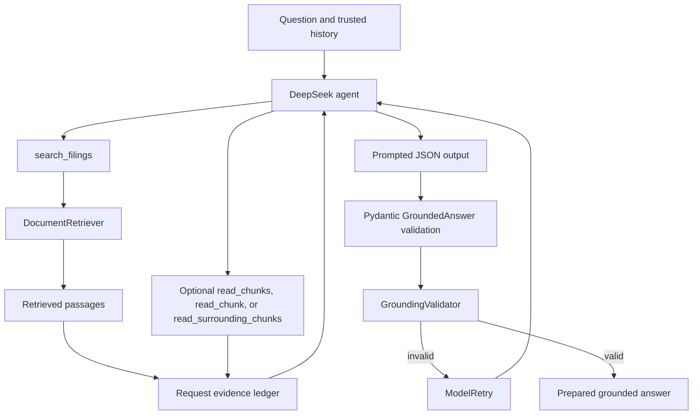

# Assistant module

This package defines the PydanticAI agent that answers filing questions. It owns
the model-facing instructions, bounded retrieval tools, request-scoped evidence,
and typed output contract. Retrieval and deterministic grounding remain separate
modules so they can be tested without calling an LLM.

## Flow



The chat orchestrator creates fresh `DocumentAgentDeps` for every request and
passes the user's question plus history loaded from Supabase to
`run_document_agent`. The agent searches the corpus, returns typed JSON, and
runs the grounding validator before the orchestrator can stream or persist the
answer.

Validated streams include a typed answer-status part and one rich citation data
part per source. Citation parts contain trusted filing metadata and the exact
verified quote; both are persisted with the message so live and reloaded answers
use the same frontend contract.

## Model configuration

`agent.py` creates an `OpenAIChatModel` pointed at DeepSeek's OpenAI-compatible
endpoint. These values come only from `app.config.settings`:

- `DEEPSEEK_API_KEY`
- `DEEPSEEK_BASE_URL`
- `DEEPSEEK_CHAT_MODEL`

The agent uses `PromptedOutput(GroundedAnswer)`. DeepSeek thinking mode rejects
the forced tool choice used by tool-based structured output, while prompted
output allows normal retrieval tool selection and still validates the final JSON
with Pydantic.

The agent allows two correction retries. The full run is additionally bounded by
the orchestrator's configured model-request and tool-call limits.

## Request-scoped dependencies

`DocumentAgentDeps` contains:

- `user_id` and `thread_id` for request identity
- A configured `DocumentRetriever`
- A `GroundingValidator`
- `registry`, the `TurnRegistry` evidence ledger for this run

Every tool registers its response with `TurnRegistry`. `require()` prevents
follow-up tools from reading arbitrary or guessed chunk IDs. Nothing in the
registry is shared between users, threads, or agent runs.

## Tools

The tools execute sequentially because follow-up reads depend on evidence found
by earlier searches.

### `search_filings`

Runs hybrid semantic and full-text retrieval with optional ticker, filing-form,
and fiscal-year filters. The full question is embedded for semantic search; a
deterministic preprocessing step removes request-language noise and values
already represented by filters, then sends up to five terms to full-text search
as a relaxed `OR` expression. Every returned seed and neighboring passage is
recorded in the evidence ledger.

### `read_chunk`

Rereads one chunk without neighboring context. The chunk must already exist in
the evidence ledger. A missing or unauthorized chunk causes `ModelRetry` instead
of exposing an unrestricted corpus lookup.

### `read_chunks`

Bulk-reads previously discovered chunks without neighboring context. Every ID
must already exist in the turn registry, and the request is bounded by the same
hard retrieval ceiling as search.

### `read_surrounding_chunks`

Fetches a bounded context window around a previously discovered chunk. Newly
returned neighbors are added to the ledger and may then be cited.

## Output contract

`outputs.py` defines three immutable Pydantic models.

`GroundedAnswer` contains:

- `status`: `answered`, `insufficient_evidence`, or `refused`
- `answer`: the user-facing text
- `citations`: model-selected chunk IDs and exact supporting quotes
- `chart`: an optional grouped bar chart whose points reference citation positions

`Citation` contains only the model's evidence claim: position, chunk ID, and
quoted text. The model does not supply trusted filing metadata.

`SourcePassage` is constructed by the grounding validator from the retrieved
passage. It contains the verified document ID, ticker, filing type and date,
accession number, URL, page, section, and quote used by streaming and persistence.

## Instructions and grounding

`instructions.md` is the model-facing product contract. It requires corpus-only
answers, numbered citations on every paragraph or bullet, exact source quotes,
clear insufficient-evidence responses, and refusal of investment advice.

Instructions guide model behavior, but they are not the security boundary.
`GroundingValidator` independently verifies that:

- Answer citation markers and citation positions agree.
- Every answer paragraph or bullet has a citation.
- Every cited chunk was retrieved during this run.
- Every quoted excerpt occurs in the cited passage.
- Every plotted value appears in the verbatim quote for its referenced citation.
- Refusal and insufficient-evidence responses contain no citations.

When the model attaches a verbatim quote to the wrong neighboring chunk, the
validator may resolve it to a different passage only if that quote has one exact,
unique match in the same turn registry. Missing or ambiguous quotes still fail
closed.

An invalid result raises `ModelRetry`. If the model cannot correct the output
within its retry budget, the request fails closed and no answer is streamed or
persisted.

## Tests

Run deterministic assistant and grounding tests:

```bash
cd backend
uv run pytest tests/assistant tests/grounding -m "not integration"
```

Run the live agent smoke test:

```bash
uv run pytest -s -m integration tests/assistant/test_smoke.py -v
```

The live test uses DeepSeek for generation, OpenAI for embeddings, and Supabase
for retrieval. It loads credentials from `backend/.env`, makes billable network
requests, and verifies that the resulting Apple answer has validated sources.

## Files

- `agent.py`: model, run entry point, and output-validation retry hook
- `tools.py`: the four bounded retrieval tools
- `deps.py`: request dependencies and `TurnRegistry`
- `outputs.py`: typed answer, citation, and trusted source models
- `instructions.md`: corpus, citation, uncertainty, and refusal rules
- `../grounding/validator.py`: deterministic grounding enforcement
- `../chat/orchestrator.py`: history loading, run limits, and agent execution
