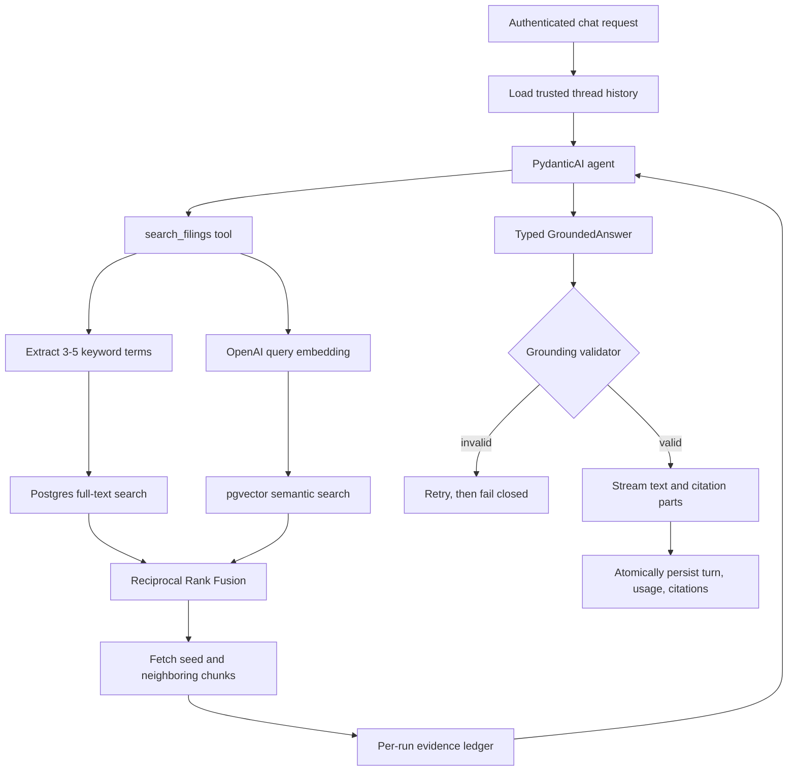
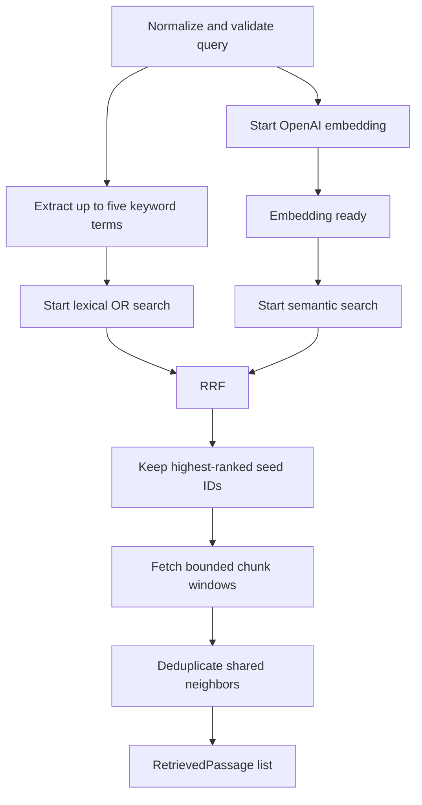

# Retrieval and grounding pipeline

Document Copilot turns an authenticated analyst question into a validated,
citation-bearing answer. Retrieval finds candidate filing passages; the agent
may inspect only evidence discovered during that run; grounding verifies the
answer before any text reaches the browser.

## End-to-end flow



The request lifecycle is:

1. `POST /chat/stream` verifies that the authenticated user owns the thread.
2. `prepare_turn()` loads history from Supabase. Client-supplied history is not
   trusted as the model's conversation record.
3. The orchestrator creates request-scoped retrieval dependencies and runs the
   DeepSeek model through PydanticAI. A run is limited to eight model requests
   and six tool calls.
4. Agent tools search or inspect filing chunks. Every returned passage is added
   to a request-local evidence ledger.
5. DeepSeek returns a Pydantic-validated `GroundedAnswer` using prompted JSON.
   Prompted output is used because DeepSeek thinking mode does not support the
   forced tool choice used by structured output tools.
6. The grounding validator checks the structured answer against the evidence
   ledger. Invalid output is retried twice, then rejected.
7. Only validated text and `data-citation` parts are streamed to the browser.
8. After streaming the answer, one database function atomically stores the user
   message, assistant message, AI SDK parts, model usage, citations, and updated
   thread timestamp.

Generation is completed and validated before visible text begins. The first
token takes longer to appear than raw model streaming, but an unsupported
partial answer cannot leak before grounding succeeds.

## Hybrid retrieval

`DocumentRetriever.search()` executes the retrieval portion of the flow:



The lexical branch starts immediately because keyword extraction is a small,
deterministic in-memory operation. It removes question-language noise and
ticker, form, and fiscal-year values already represented by structured filters,
then keeps up to five unique terms in query order. Short, specific queries may
contain fewer than three terms; the extractor never invents terms merely to
reach a quota. At the same time, OpenAI embeds the complete normalized question.
Semantic search starts when that vector is available, overlapping with any
lexical work still in flight. Pending sibling work is cancelled if either
branch fails.

Semantic search uses pgvector cosine distance and exposes cosine similarity as
its local score. Lexical terms are joined with `OR` for recall, then searched
with PostgreSQL `websearch_to_tsquery('english', ...)` and ranked by
`ts_rank_cd`; chunks matching several terms can rank above single-term matches.
Those raw scores are not comparable, so `reciprocal_rank_fusion()` combines
result positions:

```text
RRF score(chunk) = sum(1 / (k + rank))
```

With the default `k=60`, a chunk found by both methods receives contributions
from both rankings. The highest-scoring chunks become seeds. PostgreSQL then
returns each seed plus a bounded number of adjacent chunks from the same filing.
Overlapping windows are deduplicated while `seed_chunk_ids` retains why each
passage was included.

Only network-bound work is parallelized. RRF, validation, and passage assembly
are small in-memory operations. Semantic search must wait for the embedding,
and window fetching must wait for fused seed IDs.

## Defaults and limits

| Setting | Default | Valid range | Purpose |
| --- | ---: | ---: | --- |
| Embedding model | `text-embedding-3-small` | Configured in `app/config.py` | Embeds the normalized query. |
| Embedding dimensions | `1536` | Positive; must match `vector(N)` | Validates query and stored vectors. |
| Candidate count | `50` per method | `1`–`100` | Candidates fetched before fusion. |
| Result limit | `10` seeds | `1`–candidate count | Seeds retained before context expansion. |
| RRF constant | `60` | Positive | Dampens differences between high ranks. |
| Lexical keywords | Up to `5` | Fewer for short queries | Builds the full-text `OR` query. |
| Neighbor radius | `1` | `0`–`5` | Adjacent chunks fetched around each seed. |
| Model requests | `8` | Positive | Bounds retries and agent steps. |
| Tool calls | `6` | Positive | Bounds corpus operations per answer. |

All operational defaults in this table come from `app.config.settings` and can
be overridden with the corresponding uppercase environment variable. Hard
safety ceilings, filter collection sizes, and fiscal-year bounds also live in
`app/config.py`, but are not environment-configurable.

Optional retrieval filters are validated before RPC calls:

- `tickers`: at most 10
- `forms`: at most 10
- `fiscal_years`: at most 20, each from 1900 through 2100

Ticker and form values are trimmed, uppercased, and deduplicated. Empty filter
collections become SQL `NULL`, meaning no restriction.

## Agent tools and evidence ledger

The agent exposes three sequential, bounded tools:

- `search_filings` runs hybrid search and records every returned passage.
- `read_chunk` rereads a chunk already discovered by `search_filings`.
- `read_surrounding_chunks` expands context around an already discovered chunk
  and records the newly returned neighbors.

The read tools reject arbitrary chunk IDs. A chunk must first be discovered in
the current run, preventing the model from citing or probing guessed IDs. The
ledger stores full `RetrievedPassage` objects, including content, document and
chunk IDs, filing metadata, source URL, and retrieval provenance.

## Typed answer and grounding

The model returns one of three statuses:

- `answered`: a corpus-supported answer with numbered citations
- `insufficient_evidence`: a clear statement that the corpus cannot support the
  requested conclusion
- `refused`: a refusal for stock picks or investment advice

For an `answered` result, `GroundingValidator` requires:

- At least one citation.
- Unique, contiguous citation positions beginning at 1.
- Answer markers such as `[1]` that exactly match the citation positions.
- A citation marker in every non-empty paragraph or bullet.
- Every cited chunk ID to exist in the current run's evidence ledger.
- Every quoted excerpt, after whitespace normalization, to occur verbatim in
  the cited passage.

`insufficient_evidence` and `refused` results must not contain citations.
Trusted `SourcePassage` metadata is constructed from the retrieved passage, not
from model-provided ticker, filing, page, section, or URL values.

Grounding errors trigger a model correction retry. If retries are exhausted,
the API returns a controlled `502` and neither streams nor persists the answer.

## Streaming and persistence

Validated responses use the AI SDK UI message stream protocol:

1. `start`
2. `text-start`
3. `text-delta`
4. `text-end`
5. One `data-citation` part per source
6. `finish`
7. `[DONE]`

The exact text and citation parts are stored so thread history can reproduce the
response. Migration `a13d8e5b72c4` extends `persist_chat_turn` to insert messages,
usage, and denormalized citation records in one transaction. If persistence
fails after streaming, the stream emits an error and omits `finish`.

## Testing

Run the deterministic suite without external services:

```bash
cd backend
uv run pytest -m "not integration"
```

Run live retrieval with visible stage timings:

```bash
uv run pytest -s -m integration tests/retrieval/test_smoke.py -v
```

Run the complete live agent path through DeepSeek, OpenAI embeddings, Supabase,
and grounding validation:

```bash
uv run pytest -s -m integration tests/assistant/test_smoke.py -v
```

Both integration tests load `backend/.env`, make live network requests, and may
incur small provider charges. From Jupyter, select `backend/.venv` as the kernel,
change to the backend directory, and execute the same commands with `!`.

## Module map

- `retrieval/retriever.py`: hybrid retrieval orchestration and passage assembly
- `retrieval/keywords.py`: deterministic keyword extraction and lexical query building
- `retrieval/queries.py`: bounded Supabase RPC calls
- `retrieval/fusion.py`: rank-only Reciprocal Rank Fusion
- `retrieval/models.py`: filters, ranked candidates, windows, and passages
- `assistant/agent.py`: DeepSeek agent, tools, and output retry hook
- `assistant/README.md`: assistant lifecycle, tools, output contract, and tests
- `assistant/deps.py`: request identity and evidence ledger
- `assistant/outputs.py`: typed answer, citation, and trusted source models
- `assistant/instructions.md`: model-facing corpus and citation contract
- `grounding/validator.py`: deterministic fail-closed citation validation
- `chat/orchestrator.py`: trusted history, agent run, validation, and usage
- `chat/streaming.py`: AI SDK events and post-stream persistence
- `database/chats.py`: thread storage and atomic turn RPC call
- `alembic/versions/9c01e2a83b47_add_hybrid_retrieval_functions.py`:
  semantic, lexical, and chunk-window database functions
- `alembic/versions/a13d8e5b72c4_persist_grounded_chat_turn.py`:
  atomic grounded-turn persistence
